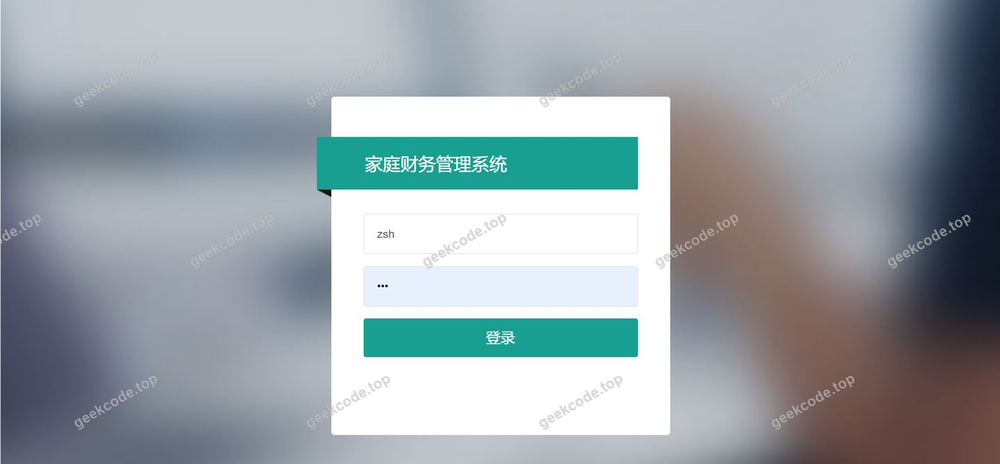
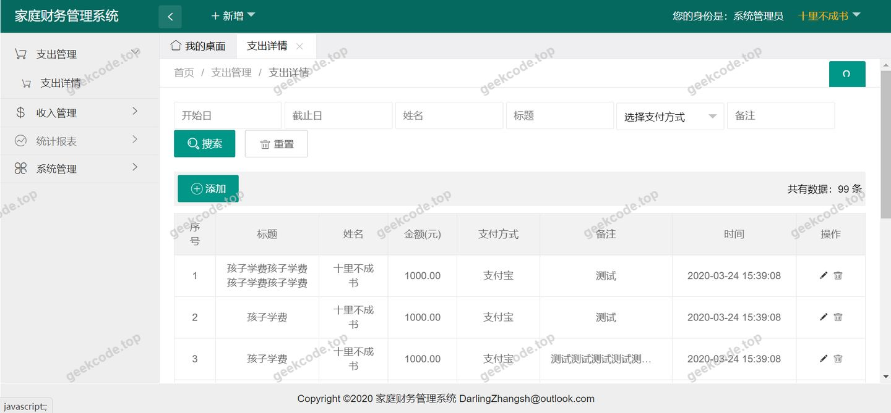
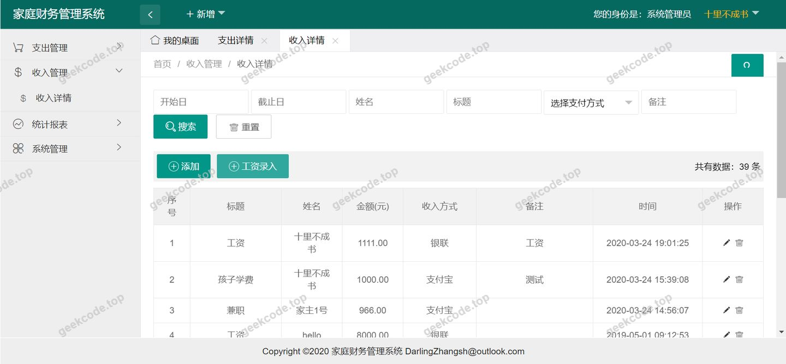
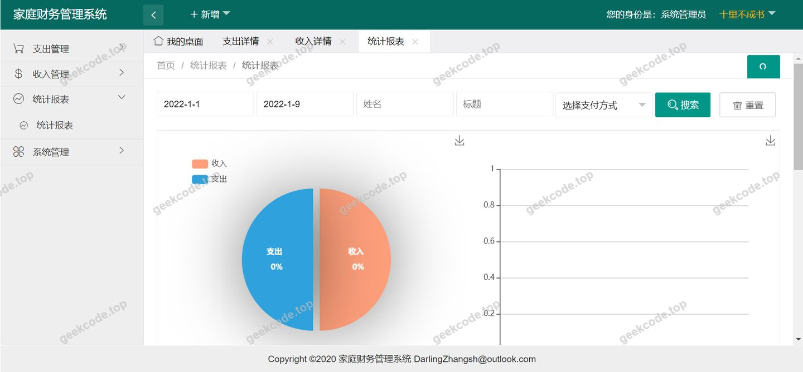
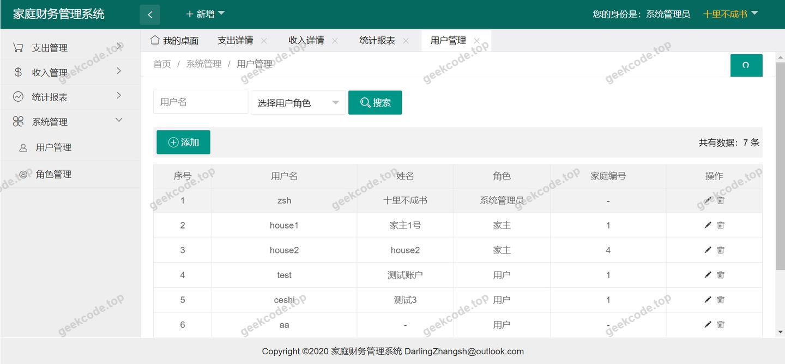
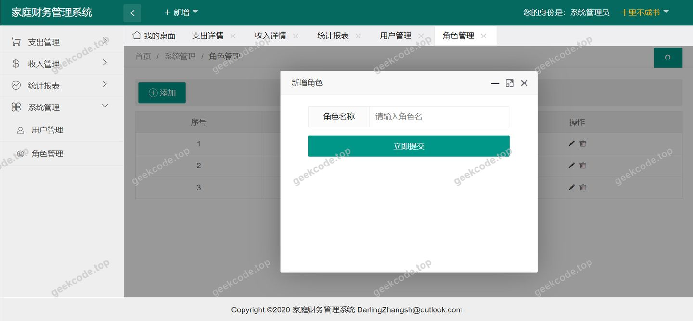

# java精品项目-基于ssm家庭财务管理系统

> 🎓 **计算机毕业设计 · java精品项目-基于ssm家庭财务管理系统**
>
> 本仓库只放**项目介绍 + 运行截图**（截图是站点带水印的原图，存在仓库 `images/` 里）。
>
> 👉 **完整可运行源码 / 数据库脚本 / 部署文档：[点我获取](https://geekcode.top/archives/java%E7%B2%BE%E5%93%81%E9%A1%B9%E7%9B%AE-%E5%9F%BA%E4%BA%8Essm%E5%AE%B6%E5%BA%AD%E8%B4%A2%E5%8A%A1%E7%AE%A1%E7%90%86%E7%B3%BB%E7%BB%9F?utm_source=github)**
>
> 💬 咨询微信：**ir9372**　|　🌐 更多项目：[极客代码 geekcode.top](https://geekcode.top/?utm_source=github)
>
> 📌 项目详情页：<https://geekcode.top/archives/java%E7%B2%BE%E5%93%81%E9%A1%B9%E7%9B%AE-%E5%9F%BA%E4%BA%8Essm%E5%AE%B6%E5%BA%AD%E8%B4%A2%E5%8A%A1%E7%AE%A1%E7%90%86%E7%B3%BB%E7%BB%9F?utm_source=github>

<table><td width="230" align="center"> <b>扫码加微信 ir9372</b></td><td valign="middle">📦 源码 = 项目介绍 + 全部运行截图 + 数据库 + 部署文档 👉 点上方任意截图，直接跳到 <b>极客代码 geekcode.top</b> 详情页</td></table>

---

<h1>java精品项目-基于ssm家庭财务管理系统</h1>
<h2>项目概述</h2>

本项目名为“基于 SSM 家庭财务管理系统”，旨在为家庭用户提供一套轻量级、易操作的数字化财务管理工具。系统核心功能聚焦于家庭日常收支的记录、分类与管理，帮助用户清晰掌握资金流向，优化家庭资产配置。适用人群主要为需要管理家庭账目、追求简洁高效操作体验的个人或家庭成员。技术架构上，后端采用 Spring Boot 框架结合 MyBatis 进行数据持久化，前端使用 Thymeleaf 模板引擎实现服务端渲染，数据库选用 MySQL。该架构在保证系统稳定性的同时，降低了前后端分离带来的复杂度，适合中小型个人项目的快速开发与部署。

<h2>技术架构</h2>
<h3>后端架构</h3>

系统后端基于 Spring Boot 构建，利用其自动配置特性简化开发流程。

<ul>
<li><strong>Web 层</strong>：通过 <code>spring-boot-starter-web</code> 提供 RESTful 接口支持及静态资源服务，集成 <code>spring-boot-starter-tomcat</code> 作为内置 Servlet 容器，实现独立运行。</li>
<li><strong>业务逻辑层</strong>：由 Spring IoC 容器管理 Bean 的生命周期与依赖注入，确保代码的低耦合性。</li>
<li><strong>数据访问层</strong>：采用 MyBatis 作为 ORM 框架，通过 <code>mybatis-spring-boot-starter</code> 实现与 Spring Boot 的无缝整合。SQL 映射文件与 Java 接口分离，便于维护复杂的查询逻辑。</li>
<li><strong>视图层</strong>：使用 Thymeleaf 模板引擎 (<code>spring-boot-starter-thymeleaf</code>)，在服务端动态生成 HTML 页面，直接响应浏览器请求，无需额外的前端构建步骤。</li>
</ul>
<h3>数据库设计要点</h3>
<ul>
<li><strong>选型</strong>：使用 MySQL 关系型数据库，通过 <code>mysql-connector-java</code> 驱动连接。</li>
<li><strong>结构</strong>：根据家庭财务管理需求，主要涉及用户表（存储账户信息）、交易记录表（存储收支明细、金额、类型、日期等）以及可能的分类字典表。</li>
<li><strong>优势</strong>：MySQL 具备成熟的事务处理能力，能够保证财务数据记录的原子性与一致性，防止因异常导致的数据丢失或错误。</li>
</ul>
<h3>核心技术选型理由</h3>

选择 Spring Boot + MyBatis + Thymeleaf 组合，是因为该方案在 Java Web 开发中最为经典且稳定。Spring Boot 减少了繁琐的配置工作；MyBatis 提供了灵活的 SQL 控制能力，适合处理财务报表类的复杂统计查询；Thymeleaf 原生支持 HTML5，且在服务端渲染模式下对 SEO 友好，同时避免了前后端分离架构中跨域、Token 管理等额外复杂性，非常适合此类单体应用。

<h2>功能模块</h2>

根据提供的上下文信息，该项目未明确区分传统意义上的“前台用户端”与“后台管理端”路由，而是作为一个统一的 Web 应用程序存在。所有功能均通过 Thymeleaf 渲染的页面呈现给用户。基于截图所示的系统运行界面，主要功能模块如下：

<ol>
<li><strong>首页/仪表盘模块</strong></li>
</ol>
<ul>
<li>展示系统概览，可能包含最新的几笔交易记录或简单的统计摘要。</li>
<li>提供导航入口，引导用户进入具体的功能页面。</li>
</ul>
<ol start="2">
<li><strong>收支记录模块</strong></li>
</ol>
<ul>
<li><strong>新增记录</strong>：允许用户输入收入或支出的金额、类别、日期及备注信息。</li>
<li><strong>列表查看</strong>：以表格形式展示历史交易记录，支持按时间或类别浏览。</li>
<li><strong>编辑/删除</strong>：对已录入的错误数据进行修改或删除操作。</li>
</ul>
<ol start="3">
<li><strong>数据管理模块</strong></li>
</ol>
<ul>
<li>提供对基础数据的维护功能，如管理支出/收入的分类标签。</li>
<li>可能包含简单的筛选功能，帮助用户查找特定时间段或特定类别的账单。</li>
</ul>
<ol start="4">
<li><strong>系统设置/个人中心模块</strong></li>
</ol>
<ul>
<li>虽然未列出具体菜单，但通常此类系统包含用户信息的查看或修改功能。</li>
<li>负责系统的初始化配置或个人偏好设置。</li>
</ul>

<em>注：由于源码上下文仅提供了技术依赖和通用截图描述，未提供具体的 Controller 方法名或详细的功能清单，上述模块划分是基于“家庭财务管理系统”的标准业务逻辑及截图中的通用界面元素推导得出的核心功能范畴。</em>

<h2>用户角色与权限</h2>

根据现有信息，该项目未提及多角色体系（如管理员与普通用户的严格隔离），也未提供后台登录或权限控制的特定代码片段。因此，本系统假设采用<strong>单一用户模式</strong>或<strong>简单会话模式</strong>。

<ul>
<li><strong>普通用户（家庭记账者）</strong></li>
<li><strong>访问范围</strong>：可访问系统的所有公开页面，包括首页、收支记录页、数据管理页等。</li>
<li><strong>功能权限</strong>：</li>
<li><strong>读权限</strong>：查看全部财务记录、统计数据。</li>
<li><strong>写权限</strong>：新增、编辑、删除个人的收支记录。</li>
<li><strong>配置权限</strong>：修改个人基本信息或系统偏好设置。</li>
</ul>

<em>说明：若系统实际包含管理员角色用于数据清洗或全局配置，需依据具体源码中的拦截器或注解进一步定义，当前上下文未体现此层级差异。</em>

<h2>项目特色与创新点</h2>
<ol>
<li>
<strong>轻量级全栈一体化</strong>
   摒弃了现代流行的前后端分离架构，采用 Spring Boot 结合 Thymeleaf 的服务端渲染模式。这种设计使得项目在开发阶段无需维护两套代码库（前端 JS/Vue/React 与后端 Java），极大地降低了学习曲线和维护成本，特别适合毕业设计场景下的快速迭代与演示。

</li>
<li>
<strong>专注核心业务逻辑</strong>
   系统剥离了复杂的社交属性或多租户架构，专注于“家庭财务”这一垂直领域。通过 MyBatis 灵活地定制 SQL 查询，能够高效处理月度报表、年度汇总等财务特有的统计需求，体现了技术选型与业务场景的高度契合。

</li>
<li>
<strong>高内聚低耦合的代码结构</strong>
   利用 Spring Boot 的自动装配机制，实现了组件间的松耦合。Controller、Service、Mapper 三层架构清晰分明，符合软件工程的高标准规范，便于后续的单元测试（依托 <code>spring-boot-starter-test</code>）和功能扩展。

</li>
</ol>
<h2>部署环境</h2>

为确保“基于 SSM 家庭财务管理系统”正常运行，需准备以下软件环境：

<ol>
<li><strong>Java 开发环境</strong></li>
</ol>
<ul>
<li><strong>JDK</strong>：建议安装 JDK 8 或 JDK 11+（Spring Boot 版本兼容性较好）。</li>
<li><strong>Maven</strong>：用于项目依赖管理和打包构建（如 Maven 3.6+）。</li>
</ul>
<ol start="2">
<li><strong>数据库环境</strong></li>
</ol>
<ul>
<li><strong>MySQL</strong>：建议安装 MySQL 5.7 或 MySQL 8.0 社区版。</li>
<li><strong>配置要求</strong>：需创建对应的数据库实例，并导入项目所需的 SQL 初始化脚本（如有）。</li>
</ul>
<ol start="3">
<li><strong>服务器环境</strong></li>
</ol>
<ul>
<li><strong>Tomcat</strong>：由于使用了 <code>spring-boot-starter-tomcat</code>，项目可直接打成 Jar 包独立运行，无需单独安装外部 Tomcat 容器。</li>
<li><strong>操作系统</strong>：Windows、Linux (CentOS/Ubuntu) 或 macOS 均可。</li>
</ul>
<ol start="4">
<li><strong>客户端环境</strong></li>
</ol>
<ul>
<li><strong>浏览器</strong>：主流现代浏览器（Chrome, Firefox, Edge, Safari）的最新稳定版本，以完美支持 Thymeleaf 生成的 HTML5 页面样式。</li>
</ul>
<ol start="5">
<li><strong>IDE 开发工具（可选，用于调试）</strong></li>
</ol>
<ul>
<li>IntelliJ IDEA 或 Eclipse（需安装 Spring Tools Suite 插件）。</li>
</ul>
<h2>五、技术特性</h2>
<ul>
<li>服务端模板渲染（Thymeleaf）</li>
</ul>
<h2>六、功能模块截图</h2>
<h3>前台用户端</h3>
<h4>系统运行界面1</h4>

<h4>系统运行界面2</h4>

<h4>系统运行界面3</h4>

<h4>系统运行界面4</h4>

<h4>系统运行界面5</h4>

<h4>系统运行界面6</h4>

---

## 获取完整源码

| 项目 | 说明 |
| --- | --- |
| 项目名 | java精品项目-基于ssm家庭财务管理系统 |
| 运行截图 | 本文 6 张（站点带水印原图，仓库 `images/` 目录） |
| 完整源码 | [https://geekcode.top/archives/java%E7%B2%BE%E5%93%81%E9%A1%B9%E7%9B%AE-%E5%9F%BA%E4%BA%8Essm%E5%AE%B6%E5%BA%AD%E8%B4%A2%E5%8A%A1%E7%AE%A1%E7%90%86%E7%B3%BB%E7%BB%9F?utm_source=github](https://geekcode.top/archives/java%E7%B2%BE%E5%93%81%E9%A1%B9%E7%9B%AE-%E5%9F%BA%E4%BA%8Essm%E5%AE%B6%E5%BA%AD%E8%B4%A2%E5%8A%A1%E7%AE%A1%E7%90%86%E7%B3%BB%E7%BB%9F?utm_source=github) |
| 咨询微信 | **ir9372**（备注：jingpin-yuanma） |
| 更多项目 | [极客代码 geekcode.top](https://geekcode.top/?utm_source=github) |

> 需要源码、部署、改配置、跑不起来等问题，加微信 ir9372 沟通，说明项目名即可。
